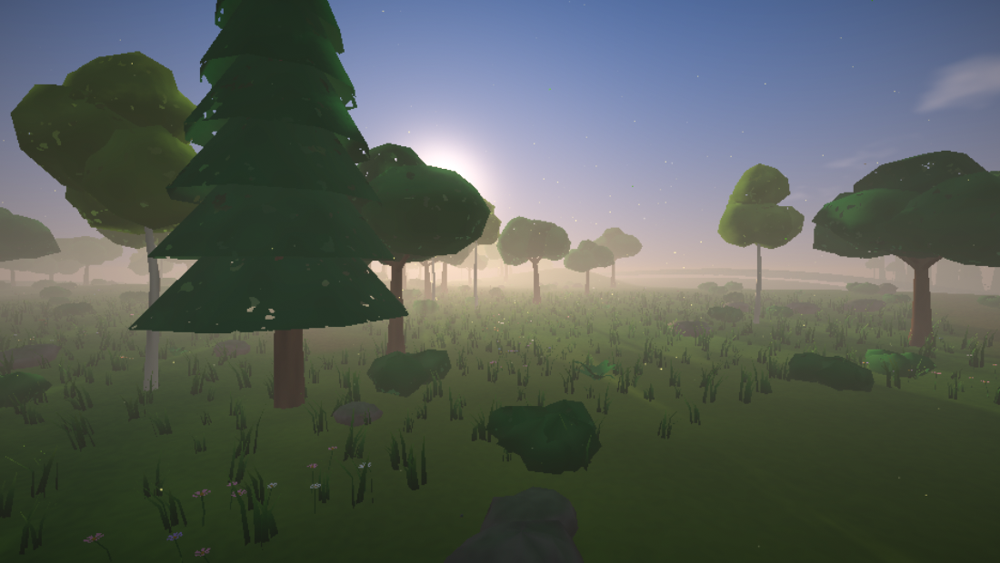
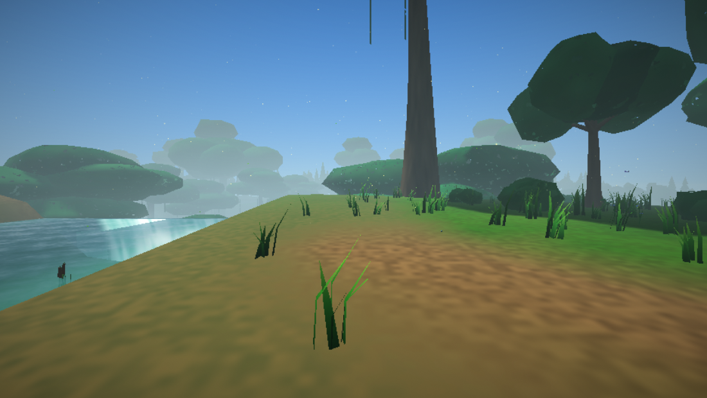
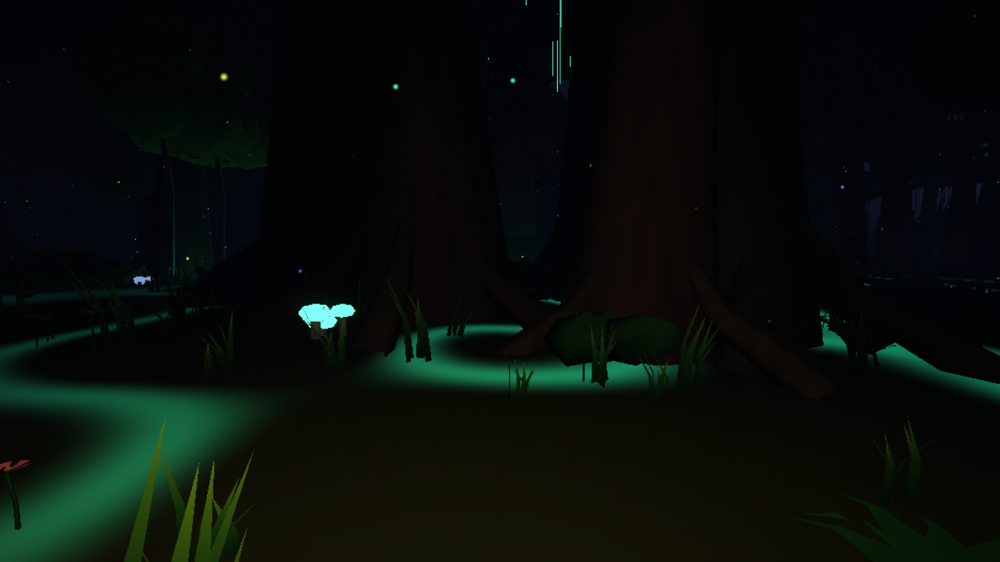
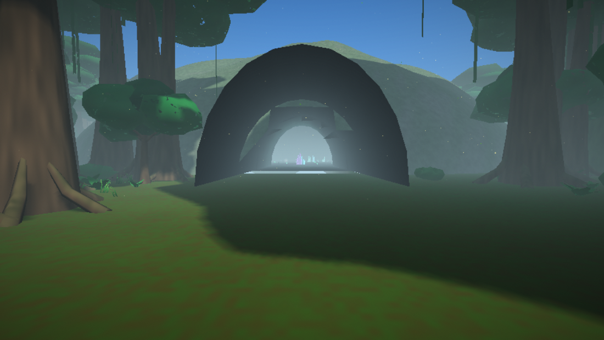
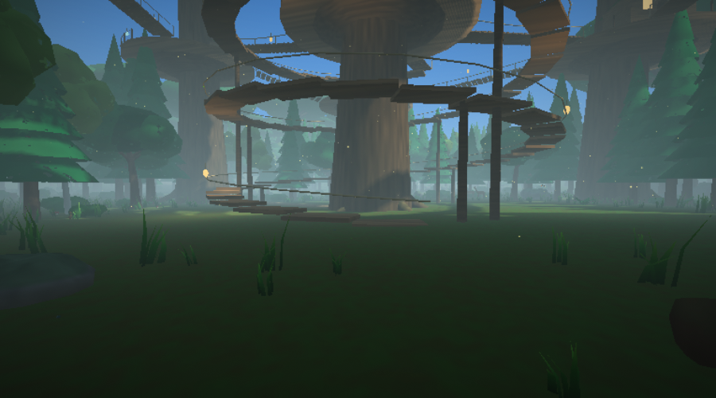
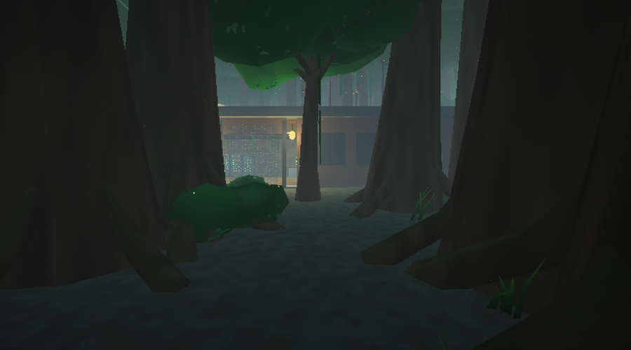
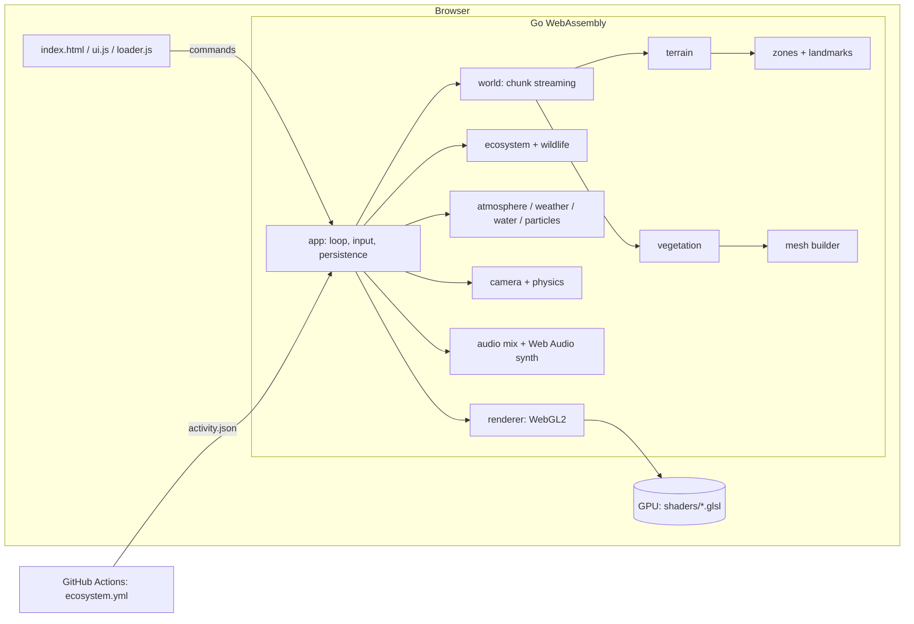

<p align="center"></p>
<h1 align="center">Evergreen</h1>
<p align="center"><b>An Infinite Living World</b></p>

<p align="center"><a href="https://0x5t4l1n.github.io/evergreen/"></a></p>
<p align="center"><sub>The animation above is generated by <code>cmd/evergreen-svg</code>. Click it to enter the real thing (replace <code>0x5t4l1n</code> with the account hosting the Pages site).</sub></p>

Evergreen is a procedurally generated forest that runs entirely in your browser. A Go program compiled to WebAssembly generates the terrain, plants, animals, weather and sky, and draws them with WebGL2. There is no server, no database and no framework, so it deploys to GitHub Pages as static files. Leave it running as a cinematic wallpaper, or take the controls and walk.

| | |
|---|---|
|  |  |
|  |  |
|  |  |

<sub>Real captures from the running build (Chrome with software WebGL, Medium preset).</sub>

## Features

- **Infinite deterministic world.** Seeded 64 m chunks stream in around you and unload behind you. The same seed always produces the same world. Terrain uses fractal and ridged noise, mountain ranges, rivers, lakes, five biomes plus a glowing grove, and a network of forest paths.
- **Nine connected zones**, repeated in every 2.8 km realm so the world never runs out of landmarks: Forest Entrance, Deep Wilderness, Emerald Falls, Bioluminescent Cave, Treehouse Sanctuary, Forgotten Civilization, Celestial Observatory, Cyber Forest Station and the World Tree.
- **Living ecosystem.** Birds fly in V formations; deer graze and flee; rabbits hop; frogs croak at night; fish school in water; butterflies, dragonflies and beetles wander. Behaviour reacts to weather, time of day, season and you.
- **Environment simulation.** Day/night with moon phases and shooting stars, local-time sync or manual time, clear/rain/storm/fog weather with lightning and wind, four seasons that recolour foliage, drop leaves and bring snow.
- **Water.** Animated waves, wave-equation ripples (rain, wading), planar reflections on High and Ultra, foam, waterfalls with mist, swimming and underwater rendering.
- **Four camera modes:** ambient wallpaper, free exploration (keyboard, mouse, touch, collision, swimming), scroll-driven journey, cinematic landmark flyovers with optional depth of field.
- **Procedural audio.** Wind, rain, thunder, water, waterfalls, birds, insects, cave ambience, station hum and more are synthesized with the Web Audio API. Nothing is downloaded, and audio only starts after your first interaction.
- **Optional GitHub integration.** Repositories grow trees, commits add plants, pull requests add flowers, stars add fireflies, releases grow the World Tree. A scheduled workflow publishes the data as static JSON; no token ever reaches the browser.
- **Performance tools.** Frustum and distance culling, LOD (terrain and trees), GPU instancing, time-sliced chunk generation, adaptive render resolution and four graphics presets.

## Quick start

Requires Go 1.23+ (and Node 18+ only for the smoke test).

```bash
git clone https://github.com/0x5t4l1n/evergreen && cd evergreen
make serve          # builds dist/ and serves http://127.0.0.1:8080/
```

| Command | What it does |
|---|---|
| `make setup` | Install smoke-test dependency and sync `wasm_exec.js` with your Go toolchain |
| `make dev` / `make serve` | Build and serve locally (`BASE=/evergreen` mimics a Pages project path) |
| `make wasm` | `GOOS=js GOARCH=wasm go build` into `dist/evergreen.wasm` |
| `make svg` | Regenerate the README SVGs |
| `make build` | Full static site in `dist/` |
| `make test` | All Go tests plus a WebAssembly vet |
| `make lint` | gofmt check and `go vet` (native and wasm) |
| `make smoke` | Headless-browser smoke test |
| `make clean` | Remove build output |

## Controls

| Input | Action |
|---|---|
| `W A S D` / arrows | Move (hold `Shift` to sprint). Moving in Ambient or Cinematic mode switches to Explore |
| Mouse (click to capture) / drag / touch right side | Look |
| Touch left side | Move |
| Wheel | Zoom (Explore) or travel (Scroll mode) |
| `Space` / `Ctrl` | Jump, swim up / swim down |
| `E` | Interact (ruins glyph, station console, observatory telescope) |
| `P` `F` `H` `M` `Tab` | Pause, fullscreen, hide interface, mute, open settings |

The interface fades away when idle. It offers mode, zone, time, weather, season, graphics, sound, seed and GitHub settings, plus screenshot, camera reset and an FPS counter.

## Configuration

Settings are saved to `localStorage` (together with your position and discovered zones) and validated on load.

| Setting | Values |
|---|---|
| `seed` | any text or number (max 64 chars) |
| `preset` | `low`, `medium`, `high`, `ultra` |
| `autoQuality` | adapt render resolution and effects to frame time |
| `timeMode` / `timeOfDay` / `timeSpeed` | `cycle`, `manual`, `local`; 0-24 h; in-world hours per real minute |
| `weather` | `auto`, `clear`, `lightrain`, `heavyrain`, `storm`, `lightfog`, `densefog` |
| `season` | `auto` (from the date), `spring`, `summer`, `autumn`, `winter` |
| `cameraMode` | `ambient`, `explore`, `scroll`, `cinematic` |
| `drawDistance` | 2-14 chunks, 0 = preset default |
| `github` | optional username |

## Architecture



Pure simulation packages build and test natively; only `renderer`, the audio engine and `app` touch `syscall/js`. More detail in [docs/architecture.md](docs/architecture.md).

```
cmd/evergreen        wasm entry point        cmd/evergreen-svg       README SVG generator
cmd/evergreen-activity  GitHub fetcher (CI)  cmd/serve               dev server (wasm MIME, sub-path)
internal/procedural  noise, RNG, hashing     internal/engine         math, config, quality, pool
internal/mesh        geometry builder        internal/vegetation     plants, rocks, biome rules
internal/terrain     heights, water, chunk meshes   internal/zones   layout, shaping, landmarks
internal/world       streaming, placement    internal/wildlife / ecosystem   animals and populations
internal/atmosphere  sky, seasons            internal/weather        weather and lightning
internal/water       ripple simulation       internal/particles      GPU plan + CPU effects
internal/camera / physics   modes, collisions   internal/audio       mix model + Web Audio synth
internal/github      activity validation     internal/renderer       uniforms, passes, WebGL2
internal/app         loop, commands, UI bridge   internal/svg         animated SVG
shaders/             GLSL ES 3.00            web/                    HTML, CSS, JS shell
```

## Documentation

- [Architecture](docs/architecture.md) and [procedural generation](docs/procedural-generation.md)
- [Shader development](docs/shaders.md)
- [Extending Evergreen](docs/extending.md): new biomes, wildlife and zones
- [GitHub integration](docs/github-integration.md)
- [Performance guidance](docs/performance.md)
- [Limitations and verification status](docs/limitations.md) (please read; it lists what was and was not tested)

## Deploying to GitHub Pages

1. Push to a repository and set **Settings → Pages → Source: GitHub Actions**.
2. `deploy.yml` builds and publishes `dist/` on every push to `main`. All asset URLs are relative, so project URLs like `https://owner.github.io/repo/` work (the smoke test serves the site under a sub-path to prove it).
3. Optional: set the repository variable `EVERGREEN_GITHUB_USERS` (e.g. `octocat,yourname`) and enable `ecosystem.yml` to publish `data/activity.json` every six hours.

## Browser compatibility

Needs WebAssembly, WebGL2 and Web Audio: current Chrome, Edge, Firefox and Safari on desktop, and recent iOS/Android browsers. Unsupported browsers see a fallback page with the animated SVG and an explanation. WebGL context loss is handled by rebuilding GPU resources. `prefers-reduced-motion` slows the ambient camera, calms particles and removes UI animation.

## Contributing, security, license

See [CONTRIBUTING.md](CONTRIBUTING.md) and [SECURITY.md](SECURITY.md). Evergreen is released under the [MIT License](LICENSE). All geometry is procedural and all sound is synthesized, so there are no third-party assets.
